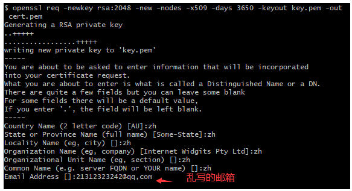

1.先全局安装 http-server

```sh
npm i http-server
```

打开当前项目目录在 git bash 中使用以下命令生成一个证书密钥对 key.pem 和 cert.pem，它将有效期约10年（准确地说是3650天）

```sh
openssl req -newkey rsa:2048 -new -nodes -x509 -days 3650 -keyout key.pem -out cert.pem
```

按步骤输入对应的信息，都可以随意填写



目录会多出两个文件 cert.pem key.pem

然后通过以下命令就可以运行https服务了

```html
http-server -S -C cert.pem -o  -p 8082  # 默认开启8080
```

http-server不支持热更新 前端开发可使用live-server代替

前端页面热更新的两种方式待更新:

1. live-server
2. anywhere